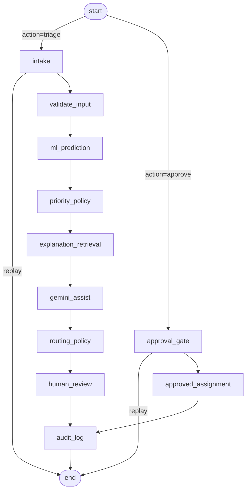

# Phase 3: LangGraph workflow and ServiceNow integration

Supervised ML (Phase 2) remains the only source of predictions. Phase 3 wraps it in a controlled,
auditable workflow and adds optional, off-by-default integrations. Everything works offline with no
credentials.

## Components

| Component | Path |
|---|---|
| Workflow nodes / graph / service | `backend/app/workflow/` |
| Routing policy (thresholds, eligibility) | `backend/app/services/routing_policy.py` |
| Gemini assistance | `backend/app/services/llm_assist.py` |
| ServiceNow client / mock / mapping / service | `backend/app/integrations/servicenow/` |
| API | `backend/app/api/v1/workflow.py`, `backend/app/api/v1/servicenow.py` |
| Persistence | `workflow_runs`, `sync_records`; `incidents.external_*`; `teams.servicenow_group_sys_id` (migration `0002`) |

## LangGraph state transitions



Incident lifecycle: `NEW -> TRIAGE_PENDING -> NEEDS_REVIEW` (workflow run) then `-> ASSIGNED`
(analyst approval). Every run ends in `NEEDS_REVIEW`; the workflow never assigns by itself.

| Node | Purpose | Notes |
|---|---|---|
| intake | Load incident, check optimistic version, compute idempotency key | Same text + inputs + model versions + routing config = replay, no new side effects |
| validate_input | Text length, impact/urgency (falls back to imported ServiceNow snapshot) | Issues are recorded and force review |
| ml_prediction | `ml_service.predict` | Retries transient `OSError`; any other fault degrades to `NOT_READY` |
| priority_policy | Deterministic impact x urgency policy | Not an ML prediction |
| explanation_retrieval | Linear feature contributions from the model | |
| gemini_assist | Optional summary / extraction / missing info | Never feeds routing; failure is non-fatal |
| routing_policy | Per-task thresholds and eligibility | Best case is `PROPOSE_ASSIGNMENT` (fast approval) |
| human_review | Persist prediction, move to `NEEDS_REVIEW` | |
| approval_gate / approved_assignment | Analyst/admin approval with reason when deviating | Reuses the Phase 1 assignment service |
| audit_log | Persist run + audit event, single commit | Whole run is one transaction |

## Routing policy

`ROUTING_ENABLED=false` by default. When enabled, a task passes only if the model is available,
trained on real (non-demo) data, reports a *calibrated* probability, and meets its threshold
(`ROUTING_THRESHOLD_CATEGORY`, `ROUTING_THRESHOLD_TEAM`); the team label must map to a local team
and the priority policy inputs must exist. Even then the result is a proposal; `auto_assign` is
always `false`. Thresholds are configuration, **not validated guarantees**. With the current
artifacts the team model is trained on synthetic data, so no proposal is ever eligible.

## Gemini (optional)

Requires `GEMINI_ENABLED=true`, `GOOGLE_API_KEY`, and a per-request `use_gemini=true`. Non-synthetic
incidents additionally need `external_data_consent=true`. Text is redacted (email, URL, IP, phone,
secret-like tokens), truncated to `GEMINI_MAX_INPUT_CHARS`, and sent as delimited data with an
injection-aware prompt. Only summary, extracted fields and missing-information hints are requested;
no team, priority, category or confidence. Output is labelled `source: LLM` and is not evidence of
model reasoning. Stored records keep sizes and redaction counts, not the sent text. Gemini is not
part of any reported evaluation.

## ServiceNow (optional)

Modes (`SERVICENOW_MODE`): `read_only` (default, GET only), `mock` (in-memory synthetic instance, no
network), `live` (PATCH allowed after approval). `SERVICENOW_ENABLED=false` returns `503
INTEGRATION_DISABLED` and `/health` reports the state.

Setup for a Personal Developer Instance:
1. Create a dedicated service account with the minimum roles: read on `incident` and
   `sys_user_group`, plus write on `incident.assignment_group` only if you will use `live`.
2. Set `SERVICENOW_INSTANCE_URL=https://devNNNNN.service-now.com`, username and password in
   `backend/.env` (never commit). Only https `*.service-now.com` hosts are accepted.
3. Start with `SERVICENOW_MODE=read_only`; check `GET /api/v1/integrations/servicenow/health`.
4. As ADMIN, map each local team to a group: `POST .../team-mappings`
   (`GET .../assignment-groups` lists sys_ids).
5. Import: `POST .../import {"sys_id": ...}` (open states only; idempotent).
6. Only for writes: set `SERVICENOW_MODE=live`.

Field mapping: ServiceNow state 1/2/3 are importable as local `NEW` (source state kept in the
snapshot); 6/7/8 are refused. `short_description` -> title, `description` -> description,
impact/urgency 1-3 feed the priority policy. ServiceNow priority is stored only as a snapshot; it is
never an approved local priority. The local team <-> `assignment_group` sys_id comes from the
explicit team mapping. Imported sample records are not a training dataset.

### Approved synchronization

1. Analyst approves an assignment locally (`/workflow/.../approve`).
2. `POST .../incidents/{id}/sync/preview` reads the remote record and returns the target instance
   host, number, sys_id, intended group and the exact `field_changes`. No write.
3. `POST .../sync/approve` with `preview_id`, `confirm: true` and `confirm_instance_host` performs
   the one PATCH (`assignment_group` only).

Guards: writes blocked outside `mock`/`live`; atomic claim of the sync record (no concurrent
duplicates); the remote `sys_updated_on` must match the preview (otherwise `409 REMOTE_CHANGED`,
re-preview); an already-applied group is recorded without a PATCH; replays of a successful sync are
no-ops; the idempotency key covers (host, sys_id, assignment, group), so an override creates a new
sync. A failed sync is stored as `FAILED` with the error; the local assignment and approval history
are untouched and the sync can be retried. Inference endpoints never write to ServiceNow.

## Data flow and privacy limitations

- Default: no data leaves the machine.
- Gemini: redacted, bounded text only, with explicit opt-in per request (and consent for non-synthetic
  incidents). Redaction is pattern-based and cannot catch all personal data.
- ServiceNow: credentials are server-side `SecretStr`; imported text is stored locally and visible to
  local staff. Basic auth is used for a developer instance; prefer OAuth for anything real.
- Not verified against a live instance: the client is tested against `httpx.MockTransport` and the
  in-memory mock only.

## Demo (offline, mock ServiceNow)

```powershell
cd backend
$env:SERVICENOW_ENABLED="true"; $env:SERVICENOW_MODE="mock"
python -m alembic upgrade head; python -m app.db.seed
python -m uvicorn app.main:app
```
Then use `/docs`: log in as `analyst@synthetic.example`, list `/integrations/servicenow/incidents`,
import one, run `/workflow/incidents/{id}/run`, approve, preview and approve the sync.