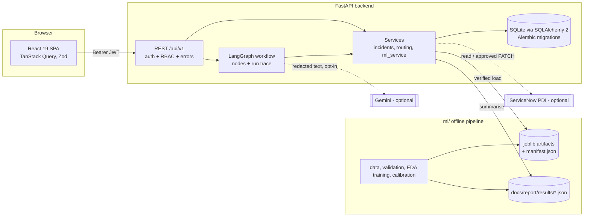
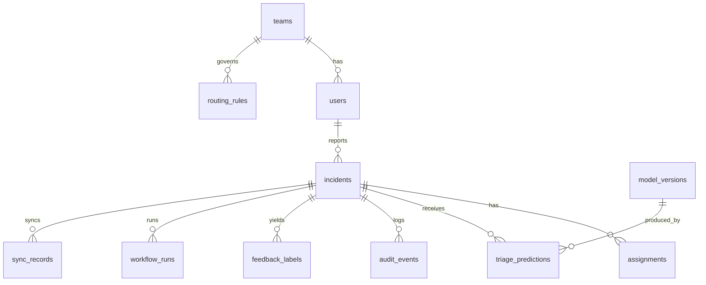
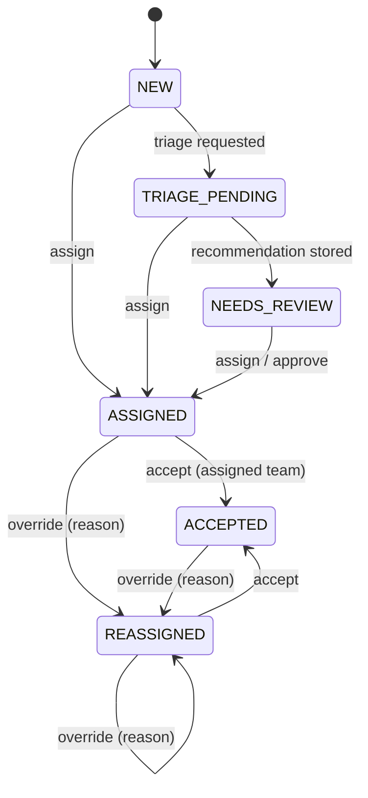
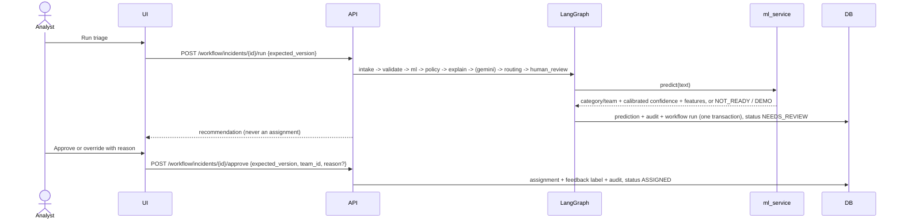

# System design

IncidentIQ-Triage is a three-part monorepo: an offline ML pipeline (`ml/`), a FastAPI service (`backend/`) that serves trained models and owns all state, and a React single-page app (`frontend/`). Supervised scikit-learn models are the only source of predictions; the LangGraph workflow, Gemini and ServiceNow are optional layers around them.

## Component view

Dotted edges are off by default (`GEMINI_ENABLED=false`, `SERVICENOW_ENABLED=false`).

## Backend layout

| Path | Responsibility |
|---|---|
| `backend/app/api/v1/` | Routers: auth, incidents, teams, analytics, models, workflow, servicenow |
| `backend/app/core/` | Settings (pydantic-settings), security (scrypt hashing, JWT), error envelope, logging |
| `backend/app/models/`, `db/` | SQLAlchemy 2 ORM, session, seed |
| `backend/app/schemas/` | Pydantic v2 request/response models |
| `backend/app/services/` | Lifecycle rules, routing policy, `ml_service.py`, `llm_assist.py`, `evaluation_service.py` |
| `backend/app/workflow/` | LangGraph state, nodes, graph, run service |
| `backend/app/integrations/servicenow/` | HTTP client, in-memory mock, field mapping, sync service |
| `backend/alembic/` | Migrations `0001` (schema + immutability triggers), `0002` (workflow runs, ServiceNow references, sync records) |

## Data model

Design rules enforced in the schema and services:

- UUID primary keys and UTC timestamps everywhere.
- Original title and description are immutable (database trigger plus a test).
- `triage_predictions` (recommendations) are separate from `assignments` and `incidents.approved_*` (approved human decisions).
- `audit_events` is append-only (triggers block UPDATE and DELETE).
- Every mutation carries `expected_version`; the update is a compare-and-set on `incidents.version`, so stale writers receive `409 STALE_VERSION`.

## Lifecycle

## Roles

| Role | Can |
|---|---|
| REPORTER | create incidents, see own incidents (no predictions) |
| TRIAGE_ANALYST | all reporter actions plus triage, assign, override, workflow, analytics, models, ServiceNow read/preview/approve |
| SUPPORT_ENGINEER | read incidents, view and accept own team's queue |
| ADMIN | everything, including team-to-ServiceNow mappings |

The frontend hides navigation by role as a convenience only; every rule is enforced server-side (`backend/tests/test_permissions.py`).

## API flow: triage and approval

## Data flow and trust boundaries

1. Incident text enters through `POST /incidents` and is stored once, unmodified.
2. Inference reads text and (optionally) impact/urgency, loads a model bundle only after path, SHA-256 and library-version checks, and returns a recommendation.
3. Nothing leaves the machine unless Gemini or ServiceNow is explicitly enabled; both are opt-in per request or per deployment, and ServiceNow writes need a preview plus explicit confirmation.
4. Browser code holds only a short-lived bearer token (sessionStorage); API keys and ServiceNow credentials exist only in server environment variables.

## Deployment

Native (recommended, see the README) or optional Docker Compose (`docker-compose.yml`, SQLite on a named volume, models mounted read-only). SQLite is adequate for a single-node academic demo; PostgreSQL has not been tried.
