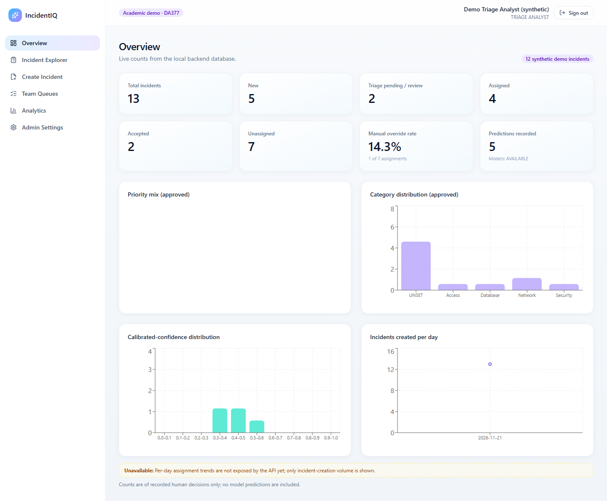
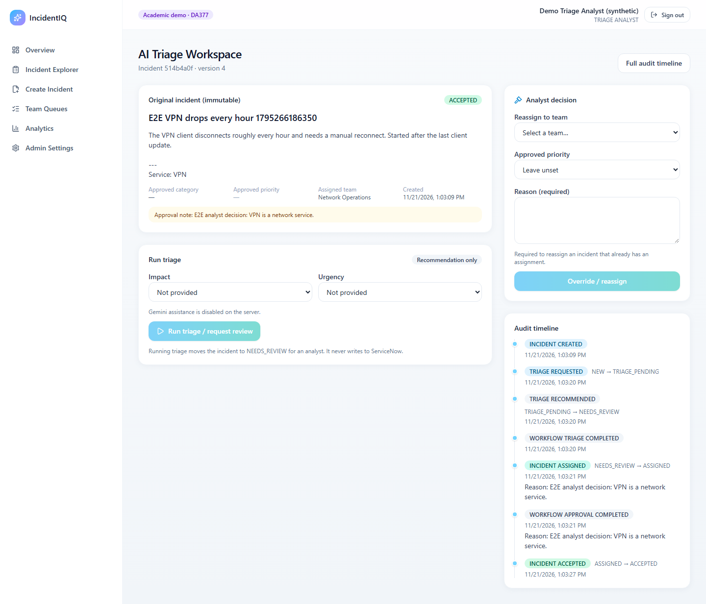
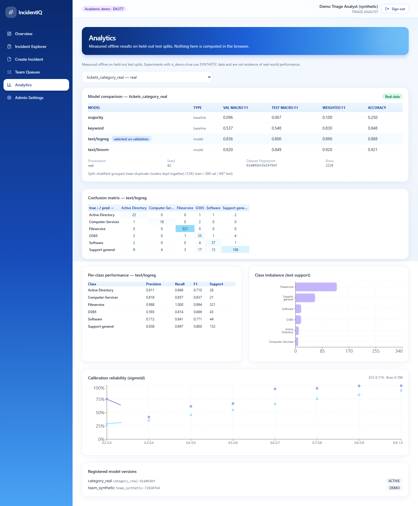

# Demo guide

Tested startup commands (Windows PowerShell and POSIX). Every step below was exercised in the Playwright E2E run against the real backend, except Gemini and live ServiceNow, which are optional and were not run against real services.

## 1. Setup (once)

Prerequisites: Python 3.11+ (lock file built on 3.13.7), Node 22+, git.

```powershell
# Windows PowerShell, repository root
.\scripts\setup.ps1 -DemoPassword "choose-a-password" -Train
```

```bash
# POSIX, repository root
DEMO_PASSWORD=choose-a-password ./scripts/setup.sh --train
```

This creates `backend/.venv`, installs `requirements-lock.txt`, copies `.env.example` to `backend/.env`, runs Alembic, seeds synthetic users/incidents, trains the models (several minutes, needs internet for the public datasets) and installs frontend packages. Omit `-Train` / `--train` to skip training; triage then returns `NOT_READY` (a valid demonstration of model-unavailable behaviour).

## 2. Start

```powershell
.\scripts\dev.ps1        # opens backend :8000 and frontend :5173
```
```bash
./scripts/dev.sh
```

Open http://localhost:5173. API docs: http://localhost:8000/docs.

## 3. Accounts (synthetic)

| Email | Role |
|---|---|
| `reporter@synthetic.example` | REPORTER |
| `analyst@synthetic.example` | TRIAGE_ANALYST |
| `engineer.network@synthetic.example` | SUPPORT_ENGINEER (Network Operations) |
| `engineer.apps@synthetic.example` | SUPPORT_ENGINEER (Application Support) |
| `admin@synthetic.example` | ADMIN |

Password: the `DEMO_PASSWORD` you used at setup (or the one printed once by the seed script). Never reuse these accounts outside a local demo.

## 4. Ten-step walkthrough

1. **Login** as `reporter`; note that Analytics and Admin are absent from the sidebar.
2. **Create Incident**: "VPN disconnects every hour", service VPN. The page shows the stored incident (status `NEW`).
3. Sign out, sign in as `analyst`; open **Incident Explorer**, search for the title, open it.
4. In the **AI Triage Workspace** click *Run triage / request review*. Point out three separate panels: ML prediction (sky, with a DEMO banner for the synthetic team model, calibrated confidence and influential features), deterministic priority policy (teal; needs impact and urgency), and the optional Gemini panel (disabled offline).
5. Read the **uncertainty warnings** (routing disabled, low confidence, demo model). The incident is now `NEEDS_REVIEW`; nothing has been assigned.
6. **Approve** the recommended team, or choose another team with a reason (an override). Confirm in the dialog.
7. Sign in as `engineer.network`; open **Team Queues**; **Accept**.
8. Open the **Audit Timeline**: created, triage requested/recommended, workflow completed, assigned, approval, accepted.
9. As `analyst`/`admin` open **Overview** (counts, override rate, confidence histogram) and **Analytics** (measured model tables; DEMO experiments are labelled).
10. As `admin` open **Admin Settings** for team mappings, thresholds and ServiceNow/Gemini status.

## 5. ServiceNow (your developer instance)

Set in `backend/.env`: `SERVICENOW_ENABLED=true`, `SERVICENOW_MODE=read_only` plus `SERVICENOW_INSTANCE_URL`/`SERVICENOW_USERNAME`/`SERVICENOW_PASSWORD`, restart the backend. Use the ServiceNow page: list and import an incident, run the workflow, approve, `sync/preview` and `sync/approve`. See [servicenow-integration.md](servicenow-integration.md).

## 6. Automated checks

```powershell
cd backend; .\.venv\Scripts\python -m pytest          # 116 tests
cd ml;      $env:PYTHONPATH="src"; ..\backend\.venv\Scripts\python -m pytest   # 14 tests
cd frontend; npm run typecheck; npm run lint; npm test; npm run build
cd frontend; npx playwright install chromium; npm run e2e   # starts an isolated backend on :8100
```

`CAPTURE=1 npm run e2e` regenerates the screenshots in `docs/presentation/screenshots/`.

## 7. Screenshots





All ten captures are in [presentation/screenshots/](presentation/screenshots). They come from a throwaway E2E database with synthetic data, so counts differ from a fresh seed.

## 8. Optional Docker

```bash
DEMO_PASSWORD=choose-a-password docker compose up --build   # UI :8080, API :8000
```

Train models first (the artifacts folder is mounted read-only). The Docker files were written but **not built or run** in the authoring environment (Docker was not installed), so treat them as untested.
