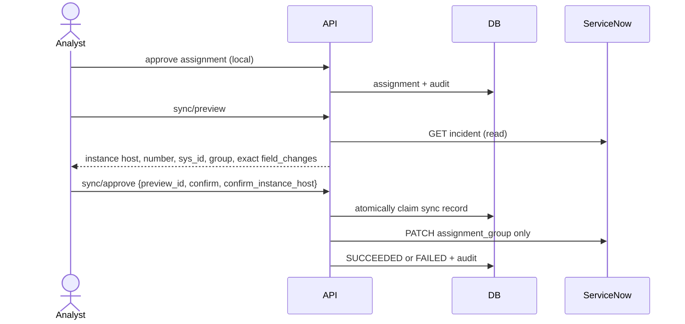

# ServiceNow integration

The adapter targets a **user-owned ServiceNow Personal Developer Instance** through the Table API. It is optional, off by default, and has been verified only against test fakes (`httpx.MockTransport` and a fake client in `backend/tests`), not yet against a live instance. ServiceNow is the project's only data source: incidents are pulled from your own instance (`python -m incidentiq_ml servicenow-pull`, then `servicenow-train`). Training needs at least 150 labelled incidents and 2 classes with 20+ rows each; otherwise the task is skipped and triage stays NOT_READY. Pulled data is git-ignored and never committed. Admins can create local teams from ServiceNow groups (`POST /integrations/servicenow/assignment-groups/import`).

## Modes

| `SERVICENOW_MODE` | Behaviour |
|---|---|
| `read_only` (default) | GET only; writes blocked |
| `live` | PATCH `assignment_group` allowed after explicit approval |

`SERVICENOW_ENABLED=false` makes every integration endpoint return `503 INTEGRATION_DISABLED`.

## Configuration (server-side only, `backend/.env`)

```
SERVICENOW_ENABLED=true
SERVICENOW_MODE=read_only
SERVICENOW_INSTANCE_URL=https://devNNNNN.service-now.com
SERVICENOW_AUTH=basic          # or oauth
SERVICENOW_USERNAME=...
SERVICENOW_PASSWORD=...
```

Only `https://*.service-now.com` hosts are accepted. Credentials are `SecretStr` and never returned by the API or present in browser code. Use a dedicated service account with read on `incident` and `sys_user_group`, and write on `incident.assignment_group` only if you will use `live`.

## Endpoints

| Endpoint | Roles | Purpose |
|---|---|---|
| `GET /integrations/servicenow/health` | analyst, admin | state and reachability |
| `GET /integrations/servicenow/incidents[/{sys_id}]` | analyst, admin | paginated read-only view |
| `GET /integrations/servicenow/assignment-groups` | analyst, admin | groups with sys_ids |
| `POST /integrations/servicenow/import` | analyst, admin | idempotent import of an open record |
| `GET/POST /integrations/servicenow/team-mappings` | analyst+ / admin | local team to group sys_id |
| `POST .../incidents/{id}/sync/preview` | analyst, admin | exact intended change, no write |
| `POST .../incidents/{id}/sync/approve` | analyst, admin | the only write path |
| `GET .../incidents/{id}/sync` | staff | sync history |

## Field mapping

| ServiceNow | Local |
|---|---|
| `sys_id` | `incidents.external_sys_id` (stable identifier) |
| `number` | `incidents.external_number` |
| `short_description` / `description` | title / description (original text stays immutable after import) |
| `impact`, `urgency` (1-3) | inputs to the priority policy |
| `priority` | stored in the snapshot only; never an approved local priority |
| `state` 1, 2, 3 | importable as local `NEW` (source state kept in snapshot) |
| `state` 6, 7, 8 | refused (resolved/closed/cancelled) |
| `assignment_group` sys_id | local team via an explicit admin mapping |

## Approved synchronisation



Guards: writes need mode `live`; the typed host must match the target instance; the remote `sys_updated_on` must equal the preview (else `409 REMOTE_CHANGED`); an already-applied group is recorded without a PATCH; replays are no-ops; the idempotency key covers (host, sys_id, assignment, group). A failed sync is stored as `FAILED` and never removes the local approval, and it can be retried. Model inference never writes to ServiceNow.

## Autopilot (optional, off by default)

With `AUTOPILOT_ENABLED=true` (and the ServiceNow integration enabled) the backend polls every
`AUTOPILOT_INTERVAL_SECONDS` for tickets in state New with no assignment group, imports each once,
and runs the triage workflow with the ticket's impact/urgency. Gemini is never called automatically.

- Default outcome: the incident waits in `NEEDS_REVIEW` with a recommendation for an analyst.
- With `AUTOPILOT_AUTO_ASSIGN=true` **and** `ROUTING_ENABLED=true`, an incident is assigned locally only
  if the routing policy returns `PROPOSE_ASSIGNMENT` (calibrated confidence above both thresholds,
  models trained on ServiceNow data, team maps to a local team). The decision is attributed to the
  inactive system user `autopilot@system.local` and audited (`AUTOPILOT_AUTO_ASSIGNED`).
- The autopilot never PATCHes ServiceNow. Writing the group back still needs the preview and
  typed-host confirmation flow.
- Admin can run one cycle via `POST /integrations/servicenow/autopilot/run`; status is at
  `GET /integrations/servicenow/autopilot`.
- Thresholds are not validated on independent data and the models are trained largely on
  template-generated seed tickets, so treat auto-assignment as a demonstration.

## Reliability

Timeouts, bounded retries with backoff for transient errors, `Retry-After` handling for HTTP 429, offset pagination, and mapped errors (auth, permission, not found, rate limit, timeout).

## Safe local demo

```powershell
cd backend
$env:SERVICENOW_ENABLED="true"; $env:SERVICENOW_MODE="read_only"
python -m uvicorn app.main:app
```

Log in as `analyst@synthetic.example`, import an incident from your instance, run the workflow, approve, then preview and approve the sync.

## Using the web UI

- **ServiceNow** (sidebar, analyst/admin): connection status, remote incidents (search, state filter, pagination, **Import**) and assignment groups with their sys_ids.
- **Admin Settings**: map each local team to a ServiceNow assignment group (admin only).
- **Incident page** (imported incidents only): the *ServiceNow sync* panel. *Preview sync* shows the instance host, number, sys_id, target team, mode and the exact field changes. Approval requires ticking the confirmation box and typing the instance host. In `read_only` mode the panel shows that writes are disabled and offers no approve button. Sync history and audit events appear below.

## Privacy

Imported text is stored in the local database and visible to local staff. Do not import real employee data into a shared demo. Basic auth is for a developer instance; prefer OAuth for anything beyond that.
